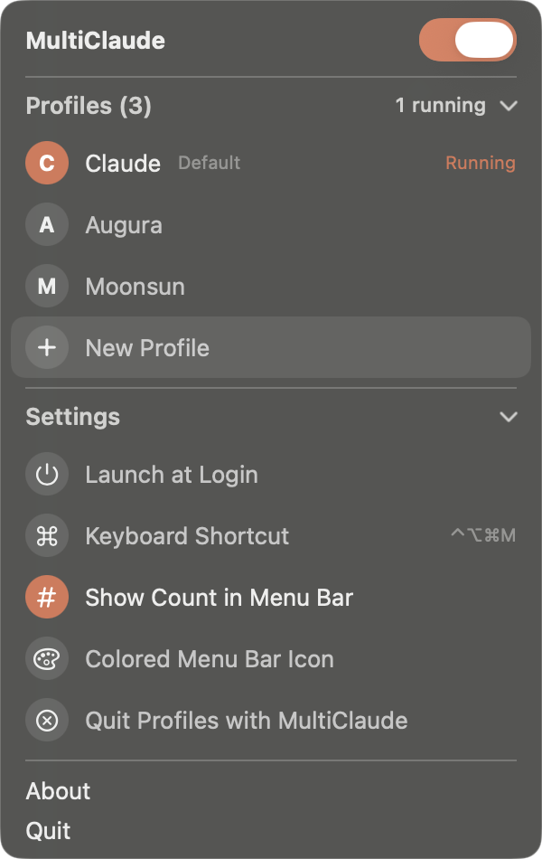

# MultiClaude

A menu bar app for running several Claude desktop accounts on one Mac.

Each profile is its own Claude data folder (`--user-data-dir`), so every profile keeps its own sign-in, chats and settings. You can have a personal account, a work account and a client account open side by side.



## Install

With [Homebrew](https://brew.sh):

```bash
brew install --cask quentincar0n/tap/multiclaude
```

Or by hand:

1. Download `MultiClaude-<version>.zip` from [Releases](https://github.com/QuentinCar0n/multiclaude/releases) and unzip it.
2. Move `MultiClaude.app` to Applications.
3. The app is not notarized, so macOS blocks the first launch. Either right-click the app and choose Open, or run:

   ```bash
   xattr -dr com.apple.quarantine /Applications/MultiClaude.app
   ```

Needs macOS 15 or later and the [Claude desktop app](https://claude.ai/download) in `/Applications`. Runs on Apple silicon and Intel.

## Use

- **Click a profile** to open it. If it already runs, the click brings it forward.
- **Hover a running profile** and click the ✕ to quit it.
- **New Profile** creates `~/Library/Application Support/Claude-<Name>`. Open it and sign in to the account you want there.
- **Right-click a profile** to rename it, reorder it, show its data folder, copy a shell alias for it, or remove it from the list. Removing never deletes the data folder.
- **Header switch**: on opens every profile, off quits them all.
- **Settings**: Launch at Login, ⌃⌥⌘M to open the panel, running count in the menu bar, colored menu bar icon, quit all profiles when MultiClaude quits.

On first launch MultiClaude imports your default Claude profile, any `open -n -a "Claude" --args --user-data-dir=...` aliases in `~/.zshrc`, and any other `Claude-*` folder in `~/Library/Application Support`.

`MultiClaude --list` (the binary inside the app) prints each profile and whether it runs.

## Build

```bash
./build.sh
```

Builds a universal app, signs it ad hoc, zips it to `build/MultiClaude-<version>.zip`, then installs it to `~/Applications` and launches it. Pass `--no-install` to stop after the zip.

Single file: `main.swift`, SwiftUI inside an AppKit panel, no dependencies.

Copyright © 2026 Soma Labs.
