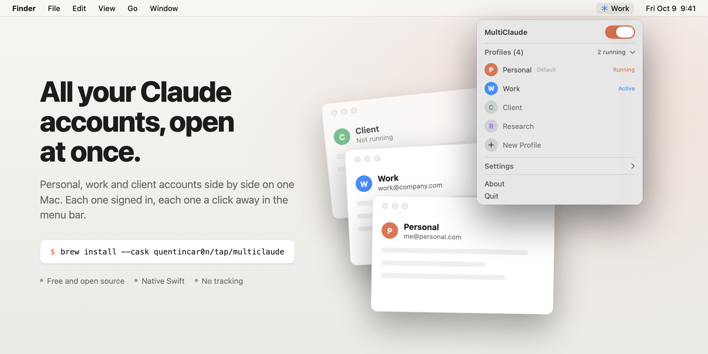
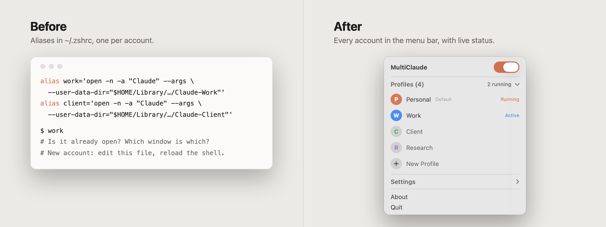
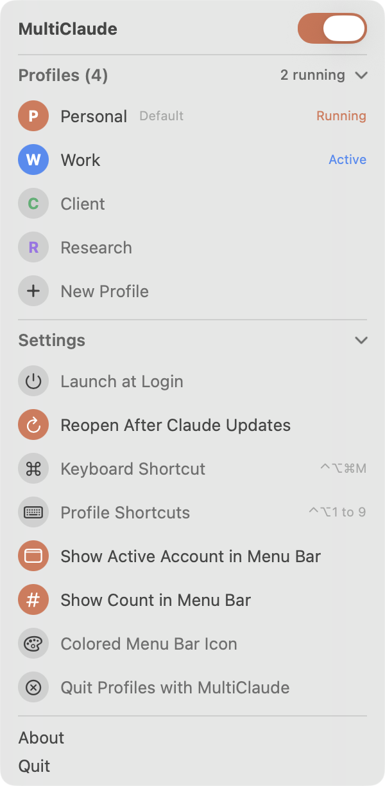

<a href="https://github.com/QuentinCar0n/multiclaude/releases/latest">
<picture>
  <source media="(prefers-color-scheme: dark)" srcset="preview/hero-dark.png">
  
</picture>
</a>

<div align="center">

# MultiClaude

**All your Claude accounts, open at once.** A free menu bar app for macOS.

[](https://github.com/QuentinCar0n/multiclaude/releases/latest)
[](https://github.com/QuentinCar0n/homebrew-tap)


[](LICENSE)

```bash
brew install --cask quentincar0n/tap/multiclaude
```

[**Download the latest release**](https://github.com/QuentinCar0n/multiclaude/releases/latest) &nbsp;&middot;&nbsp; [Why](#why) &nbsp;&middot;&nbsp; [Features](#features) &nbsp;&middot;&nbsp; [How it works](#how-it-works) &nbsp;&middot;&nbsp; [FAQ](#faq)

</div>

## Why

The Claude desktop app signs in to **one account at a time**. Plenty of people have more than one:

- a personal Pro or Max plan, and a Team or Enterprise seat from work,
- a separate organization per client, so their projects and data never mix,
- a test account to try a setup before rolling it out to a team.

Switching means signing out, signing back in, waiting for the email code and losing your place. The app can't run two accounts at once.

Claude desktop does accept `--user-data-dir`: give each copy its own folder and each one keeps its own sign-in, chats and settings. Power users wire that into shell aliases. It works, but you can't see what's open, re-running an alias doesn't bring the right window forward, and every new account means editing `~/.zshrc`.

MultiClaude is that trick with a proper interface.

<picture>
  <source media="(prefers-color-scheme: dark)" srcset="preview/before-after-dark.png">
  
</picture>

| | Shell aliases | MultiClaude |
| --- | :---: | :---: |
| Open an account | type its alias in a terminal | one click in the menu bar |
| See which accounts are open | no | yes, live |
| Bring an open account forward | re-run the alias and hope | click it again |
| Quit one account | find the right window, ⌘Q | hover, click ✕ |
| Add an account | edit `~/.zshrc`, reload the shell | type a name, press Return |
| Rename, reorder, find its data | by hand | right-click |
| Keep your existing aliases | | imported on first launch |
| Tell accounts apart | every window has the same icon | a color per account, active one named in the menu bar |
| After Claude updates itself | windows come back on the default account | profiles reopen on their own accounts |

## Features

- **One profile per account.** Each profile is its own Claude data folder, so sign-ins and chats never leak between accounts.
- **A color per account.** Each profile gets its own color, so you can tell Personal from Work at a glance. Right-click to change it.
- **Know which account is in front.** While a Claude window is active, the menu bar shows its account name in that account's color.
- **Live status.** A filled badge marks every account that is running. The menu bar shows how many are open.
- **Survives Claude updates.** When Claude updates itself it relaunches on the default account, which breaks every `--user-data-dir` setup. MultiClaude notices and reopens each profile on its own account.
- **Claude Code per account.** Right-click a profile and choose **Open Claude Code in Terminal**: the CLI runs signed in as that account, with its own `CLAUDE_CONFIG_DIR`.
- **Click to open, click again to focus.** No duplicate windows.
- **Hover to quit** a single account. The header switch opens or quits all of them at once.
- **New Profile** in one line: type a name, press Return, sign in to the new account in the window that opens.
- **Copy MCP servers between accounts.** Set your MCP servers up once, then right-click another profile and choose **Copy MCP Servers From**. Its config is backed up first.
- **Open accounts at startup.** Right-click a profile and tick **Open When MultiClaude Starts**. With Launch at Login on, your accounts are waiting every morning.
- **Duplicate a profile.** **Duplicate as New Profile** clones a profile's whole data folder, sign-in and chats included, into a new one. Handy for keeping your current history under a name like "Personal" before signing the default app in to another account. On APFS the copy is instant and takes no extra space.
- **Right-click** a profile to rename it, move it, show its data folder in Finder, copy a shell alias for it, or take it off the list.
- **Imports your setup.** First launch picks up your default Claude account, any `--user-data-dir` aliases in `~/.zshrc`, and any `Claude-*` folder in Application Support. A `Claude-*` folder created later, by an alias for example, joins the list on its own.
- **Folders follow names.** Rename a profile and its folder becomes `Claude-<Name>` the next time that account is closed. A link stays at the old path, so old aliases and Claude's own saved paths keep working.
- **Global shortcuts.** ⌃⌥⌘M opens the panel; turn on Profile Shortcuts and ⌃⌥1 to ⌃⌥9 jump straight to each account.
- **Updates itself.** Once a day MultiClaude checks for a new release, installs it in the background and restarts while the panel is closed. Your Claude windows stay open.
- **Launch at login**, light and dark mode, colored menu bar icon.
- **Tiny.** A single Swift file, no dependencies, under 1.5 MB installed.

<p align="center">
<picture>
  <source media="(prefers-color-scheme: dark)" srcset="preview/settings-dark.png">
  
</picture>
</p>

## Install

### Homebrew

```bash
brew install --cask quentincar0n/tap/multiclaude
```

### Manual

1. Download `MultiClaude-<version>.zip` from [Releases](https://github.com/QuentinCar0n/multiclaude/releases/latest) and unzip it.
2. Move `MultiClaude.app` to Applications.
3. MultiClaude is not notarized by Apple yet, so macOS blocks the first launch. Right-click the app and choose **Open**, or run:

   ```bash
   xattr -dr com.apple.quarantine /Applications/MultiClaude.app
   ```

Requires macOS 15 or later and the [Claude desktop app](https://claude.ai/download) in `/Applications`.

## Use

1. Click the ✳ icon in the menu bar.
2. Click **New Profile**, type a name such as `Work`, press Return.
3. Click the new profile. A fresh Claude window opens: sign in to your work account there.
4. From now on, click `Work` to open or focus it, and hover it to quit it.

Your default Claude account is always the first profile. It uses the app's normal data folder, so nothing changes for it.

## How it works

- **Opening** a profile runs `open -n -a Claude --args --user-data-dir=<folder>`, exactly like the alias. The default profile runs `open -a Claude`.
- **Status** comes from the running Claude processes: MultiClaude reads each one's `--user-data-dir` argument and matches it to a profile.
- **Profiles** are a small list in MultiClaude's own preferences (`me.somalabs.multiclaude`). Data folders live in `~/Library/Application Support/Claude-<Name>`, next to Claude's own. MultiClaude never moves the folder of an account that is open. **Remove from List** keeps the folder and stops MultiClaude from adding it back.

### Privacy

MultiClaude has **no analytics**. Its only network request is the daily update check: it asks GitHub for this repo's latest release, and downloads it from GitHub when it's newer. Every release is signed with a private key kept outside this repository, and MultiClaude refuses any update whose signature doesn't match the public key built into the app. It also checks the bundle identifier, the version and the code signature before swapping itself. Turn off **Update MultiClaude Automatically** in Settings to stop it. It never opens Claude's data folders, so it never sees your chats, files or sign-in tokens. It does not modify the Claude app. Removing a profile only takes it off the list: the folder stays on disk until you delete it yourself.

## FAQ

**Is this made by Anthropic?**
No. MultiClaude is an independent open source tool. It launches the official Claude app and does not change it.

**Does it work with Claude Code?**
Yes. In the desktop app, each Claude window and the Code tab inside it run with the account of its profile. For the CLI, right-click a profile and choose **Open Claude Code in Terminal**, or **Copy Claude Code Alias** for your shell. Each profile gets its own `~/.claude-<name>` folder, and Claude Code keeps a separate sign-in for each.

**Can I still use my aliases?**
Yes. MultiClaude reads the same folders, so an account opened from an alias shows as running in the panel. Right-click a profile and choose **Copy Shell Alias** to get one for a new profile.

**I already use the Claude app. How do I keep my chats when adding accounts?**
Right-click your default profile and choose **Duplicate as New Profile**, named for example `Personal`. The copy keeps your sign-in and history. You can then sign the default app out and in to another account, or simply add new profiles next to it.

**An account keeps logging out, or its sign-in never finishes.**
Claude asks every account to sign in again from time to time. Google and SSO sign-in returns from the browser through a `claude://` link that macOS gives to the first Claude window it finds, so with several accounts open it often lands in the wrong one. Right-click the account and choose **Sign In to…**: MultiClaude closes the others for the minute it takes, then reopens them.

**How do I remove an account completely?**
Right-click it and choose **Show Data Folder in Finder**, quit it, choose **Remove from List**, then trash the folder.

**What about Windows and Linux?**
MultiClaude is a native macOS app. A port is welcome.

## Build from source

```bash
git clone https://github.com/QuentinCar0n/multiclaude.git
cd multiclaude
./build.sh              # builds, installs to ~/Applications and launches
./build.sh --no-install # stops after build/MultiClaude-<version>.zip
```

Needs Xcode command line tools with Swift 6. Everything is in [`main.swift`](main.swift): SwiftUI views inside an AppKit menu bar panel.

Screenshots for this README come from a demo mode with sample profiles:

```bash
MULTICLAUDE_DEMO=1 MULTICLAUDE_PREVIEW=panel MULTICLAUDE_APPEARANCE=dark \
  ~/Applications/MultiClaude.app/Contents/MacOS/MultiClaude
```

## Releases

Push a `v*` tag and [GitHub Actions](.github/workflows/release.yml) builds a universal app, publishes the release with the matching [CHANGELOG](CHANGELOG.md) section, and bumps the Homebrew cask.

## Contributing

Issues and pull requests are welcome. See [CONTRIBUTING.md](CONTRIBUTING.md). Ideas on the list: notarized builds, per-profile keyboard shortcuts, a profile color, and a Windows port.

## License

[Apache License 2.0](LICENSE). You can use, share and modify MultiClaude freely, including commercially. Contributors grant a patent license with their code, and anyone who sues over a patent in this project loses theirs.

Claude is a trademark of Anthropic, PBC. MultiClaude is not affiliated with or endorsed by Anthropic.

<div align="center"><sub>Made by <a href="https://somalabs.me">Soma Labs</a> in Palo Alto.</sub></div>
